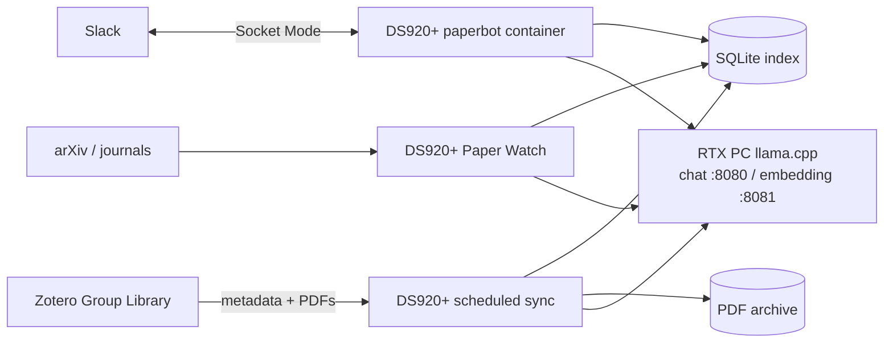

# DS920+ Production Deployment

This document describes the production deployment used by KohdaLab PaperBot.
DS920+ runs the always-on services and scheduled jobs. The RTX PC runs separate
llama.cpp servers for LLM generation and embeddings.

## Roles



| Machine | Responsibility |
| --- | --- |
| Synology DS920+ | Docker Compose, Slack bot, Zotero sync, PDF archive, SQLite, scheduler |
| RTX PC | llama.cpp: selected generation GGUF on GPU; Qwen3-Embedding-4B Q8 on CPU |
| Slack | DM RAG interface, `#paper`, `#paperbot-log` |
| Zotero | Source of truth for paper metadata and attachments |

## 1. RTX PC Checklist

Both llama.cpp servers must be reachable from DS920+:

```bash
# Replace rtx-pc.example.invalid with your inference host.
curl http://rtx-pc.example.invalid:8080/health
curl http://rtx-pc.example.invalid:8081/health
```

Install the supplied Windows startup task from an elevated PowerShell session:

```bash
New-Item -ItemType Directory -Force C:\ProgramData\PaperBot\bin
Copy-Item .\scripts\whale\*.ps1 C:\ProgramData\PaperBot\
# Place llama-server.exe and required runtime DLLs in C:\ProgramData\PaperBot\bin.
powershell -ExecutionPolicy Bypass -File C:\ProgramData\PaperBot\install_paperbot_llama.ps1
```

## 2. NAS Repository

Production path:

```bash
/volume1/docker/paperbot
```

Initial setup:

```bash
cd /volume1/docker
git clone https://github.com/woolen-yarn/kohdalab-paperbot.git paperbot
cd /volume1/docker/paperbot
mkdir -p rag_poc/papers/zotero rag_poc/index logs
cp .env.example .env
vi .env
```

Use `.env.example` as the template. Do not commit `.env`.

Minimum required variables:

```bash
SLACK_BOT_TOKEN=xoxb-...
SLACK_APP_TOKEN=xapp-...

LLAMA_CHAT_BASE_URL=http://rtx-pc.example.invalid:8080/v1
LLAMA_EMBED_BASE_URL=http://rtx-pc.example.invalid:8081/v1
LLAMA_CHAT_MODEL=paperbot-chat
LLAMA_EMBED_MODEL=qwen3-embedding-4b
PAPERBOT_TRANSLATION_MODEL=paperbot-chat
PAPERBOT_TRANSLATION_ENABLED=true
LLAMA_TEMPERATURE=0.2
LLAMA_MAX_TOKENS=1024
LLAMA_REASONING_BUDGET=0

ZOTERO_LIBRARY_TYPE=group
ZOTERO_LIBRARY_ID=...
ZOTERO_API_KEY=...

SYNC_NOTIFY_CHANNEL=#paperbot-log
SYNC_NOTIFY_MODE=verbose

PAPER_WATCH_CHANNEL=#paper
PAPER_WATCH_SUMMARY_MODEL=paperbot-chat
PAPER_WATCH_TRANSLATION_MODEL=paperbot-chat
PAPER_WATCH_TRANSLATION_ENABLED=true
PAPER_WATCH_CLASSIFICATION_MODEL=paperbot-chat
```

The generation model remains resident on the 16 GB GPU. Qwen3-Embedding-4B runs
on the CPU so retrieval never evicts generation weights. Its query instruction
is added only to queries; indexed passages are embedded without it.

## 3. Start PaperBot

```bash
cd /volume1/docker/paperbot
sudo docker compose -f docker-compose.nas.yml up -d --build paperbot
```

Check:

```bash
sudo docker ps
sudo docker logs -f kohdalab-paperbot
```

In Slack DM, send:

```text
status
```

## 4. First Sync

Run the full pipeline manually once:

```bash
cd /volume1/docker/paperbot
sudo ./scripts/sync_zotero_pipeline.sh
```

The pipeline:

1. checks llama.cpp embedding connectivity
2. fetches Zotero metadata
3. downloads only missing or changed unique PDFs
4. incrementally indexes changed PDFs into SQLite and rebuilds the lab interest profile
5. uses the refreshed terms, authors, journals, and theme combinations for Paper Watch
6. leaves the always-on Slack bot running; it reloads the SQLite index when the file changes
7. posts success or failure to `#paperbot-log`

## 5. DSM Task Scheduler

Create the tasks in DSM Control Panel > Task Scheduler. Use `root` as the owner.

| Task | Schedule | Command |
| --- | --- | --- |
| `Paperbot` | Daily 01:00 | `cd /volume1/docker/paperbot && ./scripts/sync_zotero_pipeline.sh` |
| `Paperbot-collect` | Daily 02:00 | `cd /volume1/docker/paperbot && ./scripts/collect_paper_watch.sh --lookback-days 7` |
| `Paperbot-arXiv-report` | Every Monday 09:30 | `cd /volume1/docker/paperbot && ./scripts/report_paper_watch.sh --report-scope arxiv --lookback-days 7 --post-limit 5 --min-score 45 --report-title "Paper Watch Weekly arXiv"` |
| `Paperbot-APS-JP-report` | First Monday 09:30 | `cd /volume1/docker/paperbot && ./scripts/report_paper_watch.sh --report-scope journals --report-groups aps_core,aps_ext_reviews,japan_physics --lookback-days 35 --post-limit 5 --min-score 45 --report-title "Paper Watch Monthly APS/JP"` |
| `Paperbot-Nature-report` | Second Monday 09:30 | `cd /volume1/docker/paperbot && ./scripts/report_paper_watch.sh --report-scope journals --report-groups nature_family,broad_high_impact --lookback-days 35 --post-limit 5 --min-score 45 --report-title "Paper Watch Monthly Nature/High Impact"` |
| `Paperbot-AIP-Optics-report` | Third Monday 09:30 | `cd /volume1/docker/paperbot && ./scripts/report_paper_watch.sh --report-scope journals --report-groups aip_family,iop_optics --lookback-days 35 --post-limit 5 --min-score 45 --report-title "Paper Watch Monthly AIP/Optics"` |
| `Paperbot-Nano2D-report` | Fourth Monday 09:30 | `cd /volume1/docker/paperbot && ./scripts/report_paper_watch.sh --report-scope journals --report-groups nano_2d_materials --lookback-days 35 --post-limit 5 --min-score 45 --report-title "Paper Watch Monthly Nano/2D"` |

Immediate Paper Watch alerts are off in production. The daily collection task
stores metadata, classifications, scores, and expiry timestamps in
`rag_poc/index/paper_watch.sqlite3` and does not post to Slack. Weekly and
monthly report tasks select stored papers and post one Slack message per
selected paper.

`collect_paper_watch.sh` runs two steps: first metadata collection, then RAG
enrichment for recently collected unscored candidates. Set
`PAPER_WATCH_RAG_AFTER_COLLECT=false` only when the NAS should collect metadata
without touching the RTX embedding endpoint.

Paper Watch scores are normalized to 0--100. RAG compares title and abstract
separately against representative chunks, keeps the best chunk per indexed PDF,
aggregates the top three PDFs with weights 0.6/0.3/0.1, and calibrates raw
similarity from the configured floor/ceiling to 0--1. The default report cutoff
is 45. With at least ten candidates, calibration blends the fixed absolute
range (65%) with the batch's 10th/95th-percentile range (35%). Additional
keyword concepts receive diminishing weight, and the refreshed profile supplies
capped author and journal priorities. This requires no Paper Watch database
schema change.

Recommended cadence: collect metadata every day, report arXiv every week, and
report journal groups monthly. Monthly reports are spread across four Mondays
and capped at five papers so the Slack channel stays readable.

Paper Watch groups are intentionally broad but rate-limited. The same group is
used for metadata collection and Slack reports:

| Group | Sources and report bucket |
| --- | --- |
| `arxiv_weekly` | arXiv API |
| `aps_core` | PRL, PRB, PR Applied, PR Research, PR Materials |
| `aps_ext_reviews` | PRX, PRX Quantum, PRX Energy, RMP |
| `nature_family` | Nature Physics, Nature Communications, Communications Physics, Communications Materials, npj Spintronics, npj Quantum Materials, and related Nature journals |
| `aip_family` | APL, JAP, APL Materials, APL Quantum, Applied Physics Reviews, AIP Advances |
| `japan_physics` | JJAP, APEX, JPSJ, STAM, NPG Asia Materials |
| `iop_optics` | Semiconductor Science and Technology, Journal of Physics D, Laser & Photonics Reviews, Optics Letters |
| `nano_2d_materials` | Nano Letters, ACS Nano, ACS Photonics, ACS Applied Nano Materials, ACS Applied Electronic Materials, Journal of Materials Chemistry C, 2D Materials, npj 2D Materials and Applications |
| `broad_high_impact` | Advanced Science, Advanced Materials, Science Advances, PNAS, Cell Reports Physical Science |

The default access policy is conservative: arXiv uses a submitted-date window,
Crossref requests include `mailto`, rows are capped per request, and journal
jobs are staggered by week.

Use these canonical group names in `.env`, DSM schedules, and manual commands.

## 6. Manual Paper Watch

Dry run daily metadata collection:

```bash
cd /volume1/docker/paperbot
sudo ./scripts/collect_paper_watch.sh --dry-run --sources arxiv --lookback-days 7
```

Dry run only the post-collection RAG enrichment step:

```bash
sudo ./scripts/run_paper_watch.sh --mode rag --dry-run --lookback-days 7
```

After deploying a scoring-model update, preview and rescore active stored rows:

```bash
sudo ./scripts/run_paper_watch.sh --mode rescore --lookback-days 180 --dry-run
sudo ./scripts/run_paper_watch.sh --mode rescore --lookback-days 180
```

The second command creates
`rag_poc/index/paper_watch.sqlite3.backup-YYYYMMDDTHHMMSSZ` before updating
existing score, reason, and RAG fields. It does not alter the schema and leaves
already-posted history unchanged. Use `--include-posted` only when historical
scores also need to be rewritten. RAG rescoring aborts before writing anything
if any embedding request or reference-index read fails.

Dry run the weekly arXiv report:

```bash
sudo ./scripts/report_paper_watch.sh --dry-run --report-scope arxiv --lookback-days 7 --post-limit 3
```

Dry run a monthly journal report:

```bash
sudo ./scripts/report_paper_watch.sh --dry-run --report-scope journals --report-groups aps_core,japan_physics --lookback-days 35 --post-limit 3
```

Immediate fetch-and-post mode is retained for manual debugging only:

```bash
sudo ./scripts/run_paper_watch.sh --mode run --sources arxiv --post-limit 1 --min-score 0
```

Inspect the current Zotero journal distribution in the NAS SQLite database:

```bash
sudo docker compose -f docker-compose.nas.yml run --rm paperbot \
  python - <<'PY'
import sqlite3

conn = sqlite3.connect('/app/rag_poc/index/chunks.sqlite3')
for row in conn.execute("""
    SELECT COALESCE(NULLIF(journal, ''), '(unknown)') AS journal, COUNT(*) AS n
    FROM unique_papers
    GROUP BY journal
    ORDER BY n DESC
    LIMIT 50
"""):
    print(f"{row[1]:4d}  {row[0]}")
PY
```

## 7. Logs

Scheduled logs are stored on the NAS:

```bash
sudo tail -f /volume1/docker/paperbot/logs/sync_zotero_pipeline.log
sudo tail -f /volume1/docker/paperbot/logs/paper_watch.log
sudo docker logs -f kohdalab-paperbot
```

If a DSM scheduled task does not write logs, check that the task command uses the
repository path and script directly:

```bash
cd /volume1/docker/paperbot && ./scripts/sync_zotero_pipeline.sh
```

## 8. Updating

```bash
cd /volume1/docker/paperbot
sudo git pull origin master
sudo docker compose -f docker-compose.nas.yml up -d --build paperbot
```

`docker-compose.nas.yml` uses a shared `kohdalab-paperbot:local` image for all
services. The scheduled scripts quietly rebuild that image before one-off jobs
by default, which prevents `paper-watch` from using an old image after code
changes. Set `COMPOSE_RUN_BUILD=0` only for troubleshooting.

If the RAG schema or chunking changed:

```bash
sudo REBUILD=1 ./scripts/sync_zotero_pipeline.sh
```

## 9. Runtime Data

Do not commit runtime data.

| Path | Description |
| --- | --- |
| `.env` | Slack, Zotero, and runtime secrets |
| `rag_poc/papers/zotero/` | downloaded Zotero PDFs |
| `rag_poc/index/chunks.sqlite3` | SQLite RAG database |
| `rag_poc/index/paper_watch.sqlite3` | external paper metadata, classifications, scores, and report state |
| `rag_poc/index/lab_profile.md` | generated interest profile |
| `logs/` | sync and Paper Watch logs |

## 10. Troubleshooting

`permission denied while trying to connect to the Docker daemon socket`

Run manually with `sudo`, or run DSM tasks as `root`.

`llama.cpp connection failed`

Check the RTX PC is awake and reachable:

```bash
curl http://rtx-pc.example.invalid:8080/health
curl http://rtx-pc.example.invalid:8081/health
```

`llama.cpp did not return every requested embedding`

Check the Qwen3 embedding process and its logs on the RTX PC:

```powershell
Get-ScheduledTask -TaskName "PaperBot llama.cpp"
Get-Content C:\ProgramData\PaperBot\logs\embedding.stderr.log -Tail 100
```

After switching from Nomic to Qwen3 embeddings, run a full RAG re-index. Old
Nomic vectors must not be mixed with the new 2,560-dimensional vector space.

```bash
cd /volume1/docker/paperbot
sudo docker compose -f docker-compose.nas.yml run --rm paperbot \
  python rag_poc/ingest.py --rebuild
```

Current code also stores the embedding-model label in SQLite and refuses an
incremental ingest when it detects a legacy or different embedding model.

`kohdalab-paperbot was unexpectedly stopped` after a scheduled sync

Current versions do not restart the always-on container after indexing. The bot
detects the SQLite modification time and reloads the RAG index on the next
question. If this notification continues, confirm the NAS checkout no longer
contains `docker compose ... restart paperbot` in
`scripts/sync_zotero_pipeline.sh`.

`RSS feed skipped: HTTP 403`

Some publishers block RSS user agents. PaperBot uses conservative Crossref
fallbacks where configured. Keep monthly journal watches staggered.
